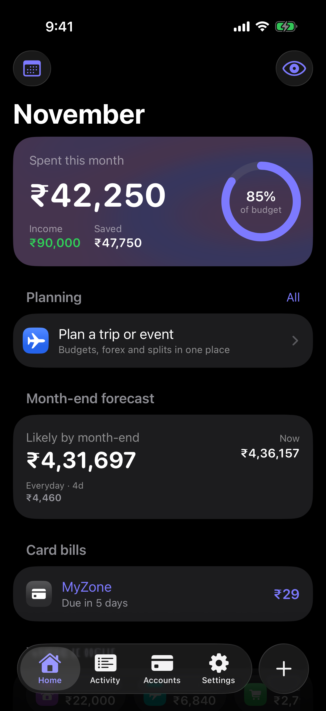
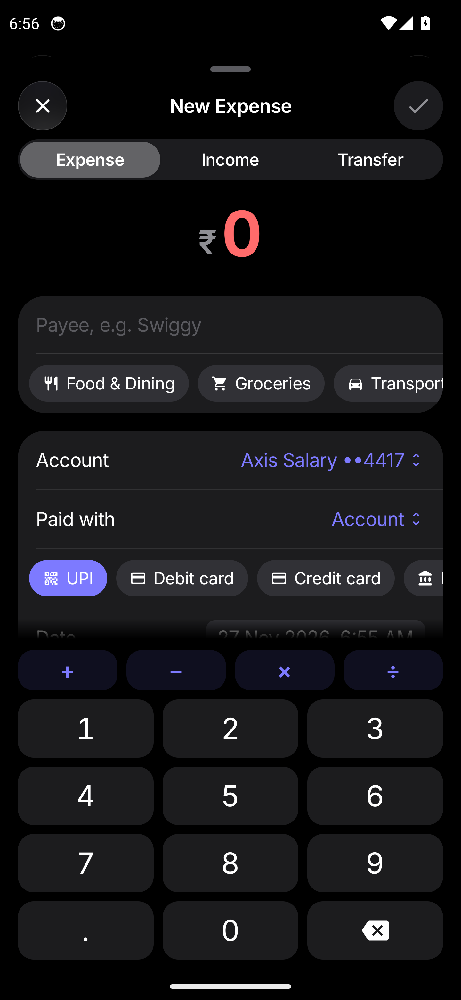
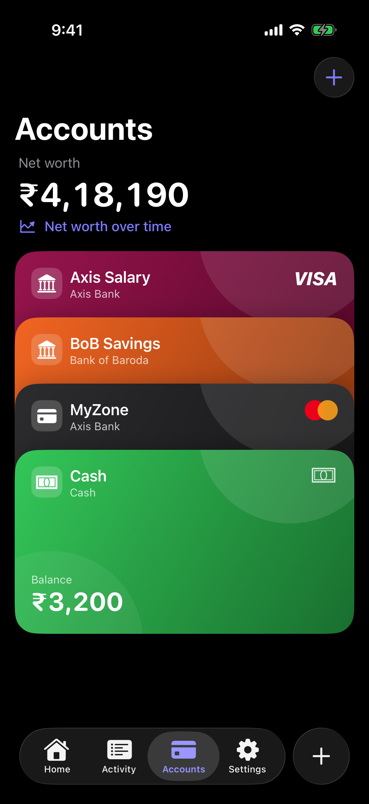
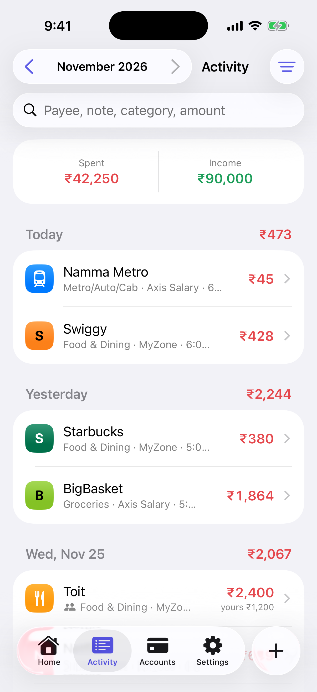

<div align="center">

# ₹ Paisa Pulse

**A free, private money tracker built for India.**
No sign-up. No servers. No ads. Your money data never leaves your phone.

[](https://github.com/PoRiFiRo123/paisa-pulse/releases/latest)







</div>

---

## ✨ Why Paisa Pulse

- **Made for Indian money:** rupees in lakh and crore, UPI, salary-day months, credit card bills, splits with friends.
- **Two native apps, one product:** SwiftUI on iPhone, Jetpack Compose on Android. They look and work the same, and a backup moves between them.
- **Liquid Glass design:** a floating glass tab bar, sheets and menus, with dark mode, accent colours and alternate app icons.
- **Private by design:** everything stays on the phone. Backups can be encrypted with your own password.

## 🚀 Features

### ⚡ Adding money in seconds
| | |
|---|---|
| **Round + button** | Sits beside the tab bar, where your thumb is. Tap for an expense; long-press for income, transfer, templates or screenshots. |
| **Quick Add keypad** | Built-in calculator (+ − × ÷), date and time, account, category, tags, card used. |
| **Payee memory** | Start typing "Swi…" and pick Swiggy; its usual category and account fill in. |
| **Templates** | Save any transaction as a template and add it again in one tap. |
| **Share a screenshot** | Share a payment screenshot from GPay, PhonePe, Paytm, BHIM, CRED, Amazon Pay, WhatsApp, Navi or your bank app. It reads the amount, payee, date and account on the phone; you check them and tap Save. |
| **Voice** (Android) | "250 lunch, 80 auto and 40 chai" adds three expenses. |
| **Statement import** | PDF (password-protected too), CSV and Excel statements from Axis, Bank of Baroda, HDFC, ICICI, SBI and cards. Spots duplicates and card bill payments, and every import can be undone. |
| **Shortcuts and widgets** | Home and Lock Screen widgets, Action Button / Control Center "Add Expense", Siri Shortcuts, app icon quick actions, Android Quick Settings tile. |

### 💱 Payment methods and currencies
- **Payment method** on every transaction (UPI, cards, net banking, NEFT/IMPS/RTGS, cash, cheque, wallet), guessed for you.
- **Any main currency** (₹ by default), a multi-currency converter, original amounts with locked, fixable rates.

### 📊 Knowing where it went
- **Home** that you arrange yourself: spending hero, month-end forecast, card bills due, budgets, goals, upcoming payments, recent activity.
- **Insights** by week, month, quarter, year or custom range, a **calendar** heatmap, and a **monthly recap** you can share as a picture.
- **Budgets** (monthly or weekly, overall or per category) with alerts at 80% and 100%.
- **Subscriptions** found automatically from repeating payments, with renewal dates and yearly cost.
- **Tags** like `#goa-trip` that total spending across categories.
- **Net worth over time**, including investments (Groww, mutual funds, PF) that you value now and then.

### ✈️ Planning trips and events
- **Trips, vacations, weekends, work trips, events, outings, rides**: each type comes with ready budget items, more for trips abroad.
- **Destinations set currencies**: spend in baht, dirhams or euros; the ₹ cost is worked out with your card's forex markup.
- **Cash and forex cards you carry**, with what's left; **who's going** becomes a split group with settle-up.
- **Spent vs budget** per item, per person and per currency; share a summary picture; keep trips out of monthly budgets if you like.

### 💳 Accounts and cards
- A **Wallet-style accounts screen**: bank accounts, credit cards, cash, wallets and investments as a stack of cards.
- **Credit card cycle:** last statement, paid so far, still to pay, unbilled spends and the due date.
- **Cards** added by camera scan or typing. Only the last 4 digits are kept, never the full number or CVV.
- **Currencies:** foreign spends are converted to rupees with live rates, plus a converter.

### 🤝 Friends and loans
- **Optional account** (email and password) to split with friends who use Paisa Pulse: find them by @username, email, phone or contacts, or share an invite QR. Shared splits, groups and trips show up on their phone to accept; your own money never leaves yours.
- **Split** a bill equally, by amounts or by shares, whoever paid. Saved groups, settle-up.
- **Request money** over Messages with a UPI QR code and a pay link; "Pay with…" opens any UPI app.
- **Loans** you gave or took: due dates, part repayments, reminders.

### 🔒 Privacy and your data
- No account, no server, no tracking. The only network calls are optional: currency rates and merchant logos.
- **App lock** with Face ID / fingerprint, and a hide-amounts switch.
- **Automatic daily backups**, optionally **encrypted with AES-256** using your password; the same file restores on iPhone or Android.
- **CSV export**, **clean-up** of old transactions (balances stay right), and Delete All Data.
- Receipt photos stay on the phone.

## 📲 Install

Get both from the [latest release](https://github.com/PoRiFiRo123/paisa-pulse/releases/latest). Every push to `main` builds a new one ([what's new](CHANGELOG.md)).

| | How |
|---|---|
| **Android** | Download `PaisaPulse.apk` on the phone and open it. Updates install over the old app from Settings › Software Update. |
| **iPhone** | Free Apple ID, no paid developer account: install `PaisaPulse.ipa` over USB with [iloader](https://github.com/nab138/iloader) (or Sideloadly), and reinstall once a week. It uses all 3 free app slots (app, widget, share extension). |

Full steps are in [docs/INSTALL.md](docs/INSTALL.md).

## 🛠 For developers

```
apple/        iPhone app (SwiftUI + SwiftData, XcodeGen project.yml)
  App/          screens          Shared/   models, money maths (also used by the widget)
  Widget/       widgets + control         Share/    share extension
androidApp/   Android app (Kotlin + Jetpack Compose)
  logic/        parsers and maths (unit tested)    ui/   screens
docs/         install guide, the static UPI pay page (GitHub Pages)
app/, src/    the original Expo app, kept as a reference for parsers
```

- **Builds:** GitHub Actions (`.github/workflows/build.yml`) builds the APK, the unsigned free-Apple-ID .ipa, runs unit tests on both apps and takes simulator screenshots.
- **Rules:** money is always integer paise; there are no minus signs in the UI (red means spent, green means received); every feature ships on both apps together.
- **Tests:** Android `./gradlew test` (in `androidApp/`), iPhone through the CI `ios` job. Statement and screenshot parsers are checked against the same expected output on both apps.
- Product spec: [`SPEC.md`](SPEC.md). Project notes and decisions: [`CLAUDE.md`](CLAUDE.md).

<div align="center">

Free forever · your data stays yours

</div>
